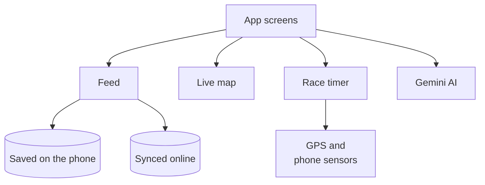
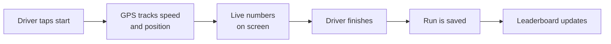
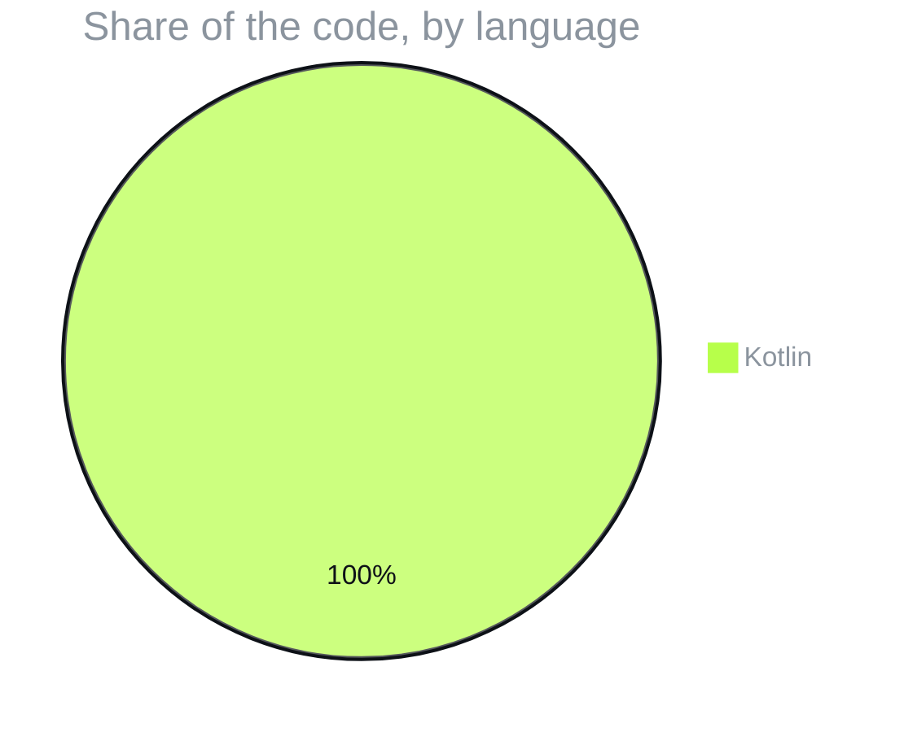

  

  
  
  
  

  
  
  
  
  

<h3 align="center">A premium automotive social and GPS telemetry app for Android, styled like a performance diagnostics cockpit.</h3>

  <a href="#️-screens">Screens</a> ·
  <a href="#️-how-the-pieces-connect">How the pieces connect</a> ·
  <a href="#️-a-race-session">A race session</a> ·
  <a href="#️-run-it">Run it</a> ·
  <a href="#-what-its-written-in">What it's written in</a> ·
  <a href="#-license">License</a>

> The native Android companion to [Apex UGR](https://github.com/F0rger123/apex-ugr), started in Google AI Studio.

> [!TIP]
> **🤖 Pasted this link into Claude or ChatGPT?** AI assistants: read [`AGENTS.md`](https://raw.githubusercontent.com/F0rger123/Apex-Cockpit/main/AGENTS.md) first. It explains what this is in plain words, which questions to ask, and how to set it up step by step. Plain-text index: [`llms.txt`](https://raw.githubusercontent.com/F0rger123/Apex-Cockpit/main/llms.txt).

## 🏎️ Screens

| | Screen | |
|---|---|---|
| 📰 | **Home feed / social feed** | Posts from drivers and clubs |
| 🏁 | **Active race** | Live telemetry while racing |
| 🎲 | **Mystery race matchmaking** | Get paired with an unknown rival |
| 🏆 | **Leaderboards & standings** | Season and event rankings |
| 🚗 | **Garage performance** | Your builds and their numbers |
| 👥 | **Car clubs & pilots hub** | Find crews and drivers |
| 📍 | **Car meets, events & challenges** | Real-world meets on a live map |
| 👤 | **Profile & settings** | Driver identity and preferences |

## 🏗️ How the pieces connect

## ⏱️ A race session

## 🛠️ Run it

**Needs:** [Android Studio](https://developer.android.com/studio) and a Gemini API key.

1. Open the project folder in Android Studio and let it sync Gradle.
2. Copy `.env.example` to `.env` and set `GEMINI_API_KEY`.
3. Remove `signingConfig = signingConfigs.getByName("debugConfig")` from `app/build.gradle.kts` if you have no debug keystore.
4. Run on an emulator or a device.

## 📊 What it's written in

## 📜 License

Released under the [MIT License](LICENSE). Use it, fork it, ship it.

  Built by <a href="https://github.com/F0rger123"><b>@F0rger123</b></a> · MIT licensed

